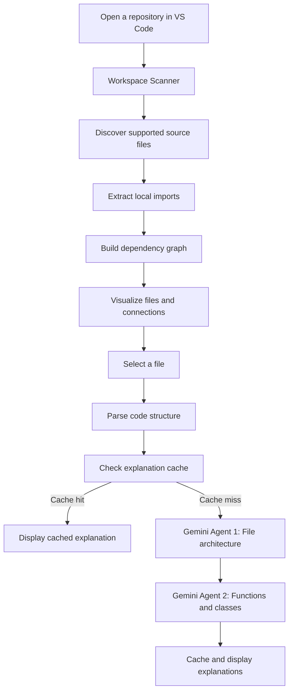

https://github.com/user-attachments/assets/6e412408-12b9-40a7-80de-50123fc009c7

 <div align="center">

# 🕸️ Webbit

### See the structure behind your code.

**An AI-powered repository intelligence and architecture visualizer for Visual Studio Code.**

[](https://code.visualstudio.com/)
[](https://www.typescriptlang.org/)
[](https://ai.google.dev/)

**The repository is the web. Files are the nodes. Dependencies are the connections.**

</div>

---

## 🎬 Demo

Explore Webbit in action through our project demonstration.

<div align="center">

### 🕸️ Watch Webbit in Action

[](./media/webbit-demo.mp4)

**[▶ Click here to watch the full screen recording](./media/webbit-demo.mp4)**

</div>

## ✨ What is Webbit?

Understanding an unfamiliar codebase can mean jumping between files, tracing imports manually, and trying to reconstruct how everything fits together.

**Webbit makes that structure visible.**

Webbit is a Visual Studio Code extension that scans your workspace, builds an interactive dependency graph, and uses Google Gemini to explain the purpose and internal structure of source files.

Instead of navigating a repository one file at a time, explore it as an interconnected system.

## 🚀 Features

### 🕸️ Repository Dependency Graph
- Scans your workspace and discovers supported source files.
- Builds a graph of files and their local import relationships.
- Displays files as nodes and dependencies as connections.
- Shows repository-level node and edge counts.
- Opens the full dependency graph in a dedicated panel.

### 🤖 AI-Powered File Explanations

Webbit uses a two-agent analysis pipeline powered by Google Gemini.

| Agent | Responsibility |
|---|---|
| **Agent 1 — Architecture Analyst** | Explains a file's role, purpose, architectural fit, and major components. |
| **Agent 2 — Function & Class Analyst** | Examines detected functions and classes, describing their purpose, inputs, outputs, internal mechanics, and dependencies. |

### 🔍 Code Structure & Dependency Insights
- View a file's detected functions.
- Inspect outgoing imports and incoming dependents.
- See line counts and basic file-level statistics.
- Open selected files directly in the VS Code editor.

### ⚡ Cached Explanations

Webbit hashes file contents and caches previous AI explanations.

When unchanged content is analyzed again, cached results can be reused without repeating parsing and AI calls.

### 🌐 Language & File Scanning

The dependency scanner currently recognizes:

`JavaScript` · `JSX` · `TypeScript` · `TSX` · `MJS` · `CJS` · `Python`

The AI analysis language detector also contains mappings for additional languages, including Go, Rust, Java, C#, C++, C, Ruby, PHP, Swift, and Kotlin. Actual parsing and graph support may vary by parser implementation.

Common generated and dependency directories such as `node_modules`, `.git`, `dist`, `build`, `out`, `.next`, and `coverage` are excluded from scanning.

---

## 🧰 Tech Stack

| Technology | Purpose |
|---|---|
| Visual Studio Code Extension API | Extension integration, commands, workspace access, and Webviews |
| TypeScript | Extension and application logic |
| Google Gemini API | AI-powered code explanations |
| Tree-sitter / web-tree-sitter | Source-code parsing |
| Cytoscape.js | Dependency graph visualization |
| Node.js | Runtime and development tooling |

---

## 📦 Getting Started

### Prerequisites

- [Visual Studio Code](https://code.visualstudio.com/) 1.85 or later
- [Node.js](https://nodejs.org/) and npm
- A Google AI API key from [Google AI Studio](https://aistudio.google.com/apikey)

### 1. Clone the repository

```bash
git clone https://github.com/BhanuPratap0805/Webbit-.git
cd Webbit-
```

### 2. Install dependencies

```bash
npm install
```

### 3. Configure your Gemini API key

1. Open the Command Palette using `Ctrl + Shift + P`.
2. Run **Webbit: Set API Key**.
3. Enter your Google AI API key.

Alternatively, configure `webbit.aiApiKey` in VS Code settings.

> Never commit your API key or expose it in source control.

### 4. Compile the extension

```bash
npm run compile
```

### 5. Launch Webbit

1. Open the project in VS Code.
2. Press `F5` to launch the Extension Development Host.
3. Open a project folder in the new VS Code window.
4. Select **Webbit** from the Activity Bar.
5. Let Webbit scan the workspace and build its dependency graph.
6. Select a file and request an AI explanation.

---

## ⌨️ Available Commands

Open the VS Code Command Palette (`Ctrl + Shift + P`) and search for:

| Command | Description |
|---|---|
| `Webbit: Refresh Workspace Analysis` | Rescan the current workspace and refresh the graph. |
| `Webbit: Explain File` | Run file explanation functionality. |
| `Webbit: Set API Key` | Configure the Google AI API key. |
| `Webbit: Open Full Dependency Graph` | Open the full graph in a dedicated panel. |

---

## 🧠 How Webbit Works



### Workflow

1. **Scan:** Webbit walks through the opened workspace and discovers supported source files.
2. **Connect:** It extracts local import relationships and resolves them to project files.
3. **Visualize:** It turns discovered files and relationships into an interactive dependency graph.
4. **Inspect:** Selecting a file reveals its basic structure and dependency information.
5. **Explain:** The analysis pipeline parses the file and uses two Gemini-powered agents to generate file-level and function/class-level explanations.
6. **Reuse:** Content-based caching avoids repeating unchanged file analysis.

---

## 🗂️ Project Structure

```text
Webbit-/
├── code-parser/             # Code parsing utilities
├── dependency-graph/        # Dependency graph modules
├── media/
│   ├── webview.html         # Webview interface
│   ├── cytoscape.min.js     # Graph visualization library
│   └── webbit-demo.mp4      # Project demonstration
├── src/
│   ├── extension.ts         # VS Code extension entry point
│   ├── parser/              # Parsing and dependency analysis
│   └── explanation/         # AI explanation pipeline and cache
├── agent1.ts                # File architecture analyzer
├── agent2.ts                # Function and class analyzer
├── agentUtils.ts            # Shared Gemini utilities
├── package.json
└── tsconfig.json
```

*This is a high-level guide; individual files may evolve as the project develops.*

---

## 🛠️ Development

Compile the project:

```bash
npm run compile
```

Watch TypeScript files for changes:

```bash
npm run watch
```

Run the cache test script:

```bash
npm run test:cache
```

Run the standalone analysis agents:

```bash
npm run agent1 -- path/to/file.ts
npm run agent2 -- path/to/file.ts
```

The standalone agents require `GOOGLE_AI_API_KEY` to be available in the environment.

---

## 🔐 API Key & Privacy

- Webbit uses a Google Gemini API key for AI-powered explanations.
- The key can be configured through the extension's **Webbit: Set API Key** command or VS Code configuration.
- Workspace source files are read locally by the extension for scanning and parsing.
- When you request an AI explanation, the selected file's source content and relevant context are sent to Google's Gemini API for processing.
- Review Google's API terms and data policies before using the extension with proprietary or sensitive code.

---

## 🗺️ Roadmap

Potential areas for future development:

- [ ] Richer repository-wide architecture summaries.
- [ ] More language-specific parsing and dependency resolution.
- [ ] Improved graph filtering and navigation for large repositories.
- [ ] Better visualization of external package dependencies.
- [ ] Cross-file architectural insights and bottleneck detection.
- [ ] Expanded tests and documentation.

---

## 🤝 Contributing

Contributions, ideas, bug reports, and feature suggestions are welcome!

1. Fork the repository.
2. Create a branch for your changes:

```bash
git checkout -b feature/your-feature
```

3. Make your changes and run the compile check:

```bash
npm run compile
```

4. Commit your changes and open a pull request.

---

## 📄 License

No license is currently specified in the repository. Until one is added, all rights remain with the copyright holder; do not assume the code is open for reuse or redistribution.

---

<div align="center">

### 🕸️ Explore the connections. Understand the architecture.

**WEBBIT — See beyond the files.**

[GitHub Repository](https://github.com/BhanuPratap0805/Webbit-)

</div>
